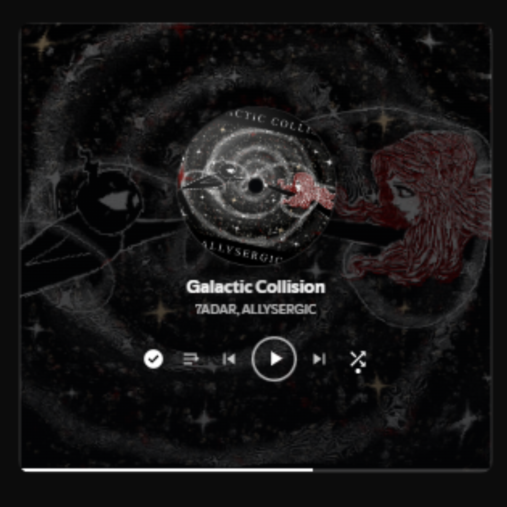
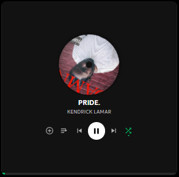
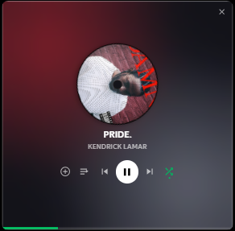
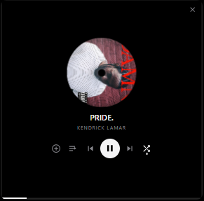
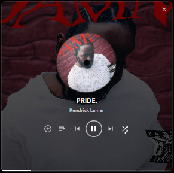

# Vinyl Mini Player

A Spicetify extension that replaces Spotify's Mini Player with its own always-on-top window: a spinning vinyl, live synced lyrics, a reorderable queue, and four themes.





## Features

- A wide bar that turns into a stacked card as the window becomes squarer or larger. Everything scales with the window.
- **Queue panel:** Drag to reorder, click a track to play it now, use the buttons to play it next or remove it, or reshuffle the tracks shown with the shuffle button in the panel header.
- Remembers its size and position. You only need to adjust the layout once; you can then move the player anywhere without losing your preferred size.
- Right-to-left lyrics such as Arabic fill from right to left.
- Lyrics are hidden in Performance mode.
- **Track change animation:** The artwork flips like a card while the title and artist glide in.
- Long titles scroll to the end, pause for three seconds, then scroll back.
- Scroll over the vinyl to change volume.
- Controls automatically hide when idle.
- Performance mode.

## Themes

<table>
  <tr>
    <td align="center" valign="top" width="50%">
      <br>
      <sub><b>Classic:</b> Follows your Spotify theme</sub>
    </td>
    <td align="center" valign="top" width="50%">
      <br>
      <sub><b>TintedGlass:</b> Album-colored glow with tint and blur controls</sub>
    </td>
  </tr>
  <tr>
    <td align="center" valign="top" width="50%">
      <br>
      <sub><b>Minimal:</b> Flat AMOLED black</sub>
    </td>
    <td align="center" valign="top" width="50%">
      <br>
      <sub><b>Liquid:</b> Rippled album art background with animated motion</sub>
    </td>
  </tr>
</table>

## Live synced lyrics

<table>
  <tr>
    <td align="center" valign="top" width="50%">
      <br>
      <sub><b>Default:</b> A single current lyric line with a smooth progress fill and horizontal scroll as the line plays.</sub>
    </td>
    <td align="center" valign="top" width="50%">
      <br>
      <sub><b>Afterimage:</b> A focused three-line stack that keeps the current lyric sharp while softly blurring the previous and next lines.</sub>
    </td>
  </tr>
</table>

## Install

### Marketplace

Open Spotify, go to Marketplace → Extensions, search for Vinyl Mini Player and click Install.

### Manual

Copy `vinyl-mini-player.js` into your Spicetify `Extensions` folder (`%appdata%\spicetify\Extensions\` on Windows, `~/.config/spicetify/Extensions/` on Linux and macOS).

Run:

```bash
spicetify config extensions vinyl-mini-player.js
spicetify apply
```

## Usage

Click Spotify's own Mini Player button, or open the profile menu and choose Vinyl Mini Player → Open / close.

Settings are in the same menu, or behind the gear button in the player bar.

## Lyrics

| Source       | Key needed | Sent to the service                           |
| ------------ | ---------- | --------------------------------------------- |
| Spicy Lyrics | Yes        | The ID of the playing track                   |
| LRCLIB       | No         | Track title, artist, album and length         |
| Spotify      | No         | Spotify's own lyrics service, same as the app |

The chosen source is tried first, followed by the others. With the default (Auto), LRCLIB can receive a track's title, artist and album when Spicy Lyrics has nothing. Pick a single source in Settings if you don't want that.

Spicy Lyrics needs your own publishable key (`sl_pk_...`) from developers.spicylyrics.org. Never use a secret `sl_sk_...` key. The source that supplied the lyrics is credited under the lyric line.

This project is unofficial and is not affiliated with Spicy Lyrics, LRCLIB or Spotify.

## Notes

The player is a Document Picture-in-Picture window (Chromium). If that is unavailable, a pop-up window is used, so allow pop-ups for Spotify.

The window cannot be truly see-through.

If something doesn't load, open Spotify's DevTools (`Ctrl+Shift+I`) and look for `[vinyl-mini-player]` messages in the console. The first line shows the version.

## Changelog

See [CHANGELOG.md](CHANGELOG.md).
